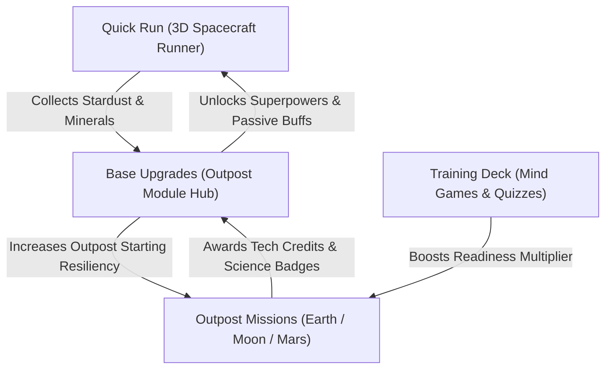

# CrewReady: Beyond Us — Project Context & Foundation Document
## NASA Space Apps Challenge 2026 | Junior Astronaut Mission Trainer

---

## 1. Problem Statement & Challenge Context

### 1.1 The Official NASA Space Apps Challenge 2026 Prompt
> **Challenge Title:** *Build a Junior Astronaut Mission Trainer*  
> **Challenge Category:** Education & Gamification | Intermediate · Youth  
>
> **Challenge Description:**  
> *"Space-themed STEM content often oversimplifies the engineering trade-offs that define a real mission or presents them at a level too complex to hold a young learner's attention. Few tools make those trade-offs both tangible and fun. Your challenge is to design and build an interactive game or app that lets students run a lunar or Martian outpost, balancing competing demands like life support, radiation shielding, power, and food production, so they experience firsthand the decisions that determine whether a mission succeeds."*

### 1.2 The Core Problem: The Pedagogical Divide
Space science education exhibits a severe attrition rate among learners aged 8–16 (Gen Alpha) caused by an unaddressed pedagogical divide:
1. **Oversimplified Gamification**: Clicker games, isolated mini-games, and trivia quizzes where oxygen, power, food, and water are independent meters. In these systems, spending power does not jeopardize oxygen recycling, and shielding failure has no secondary thermodynamic consequence. Learners memorize isolated facts without understanding engineering reality.
2. **Intimidating Industrial Simulators**: Complex flight simulators and professional telemetry dashboards featuring 150+ interdependent parameters. Young learners become overwhelmed within 3 minutes, leading to rapid bounce rates and zero conceptual retention.

**The Missing Bridge:** Neither extreme teaches the core law of space mission architecture:
$$\text{Coupled Systems Law: } \Delta \text{Protection}_A \implies -\Delta \text{Resource}_B$$
Protecting one subsystem always consumes another. Every critical decision demands an honest trade-off.

---

## 2. The Narrative Vision: From "Twinkle Twinkle" to Kazi Nazrul's "Shonkolpo"

### 2.1 The Universal Childhood Hook
From humanity's earliest universal nursery lullaby:  
*"Twinkle, Twinkle, Little Star, how I wonder what you are..."*  
to Bangladesh’s national poet Kazi Nazrul Islam’s immortal poem *Shonkolpo* (*"থাকব না কো বদ্ধ ঘরে, দেখব এবার জগৎটাকে / কেমন করে ঘুরছে মানুষ যুগান্তরের ঘূর্ণিপাকে..."* — *"I shall not stay shut in a closed room; I shall see the world, how humanity traverses from age to age..."*), we have always wondered what lies beyond us.

The curiosity of exploring the unknown is rooted from the very beginning of human life, in every child, in every country.

### 2.2 The Generational Mission
Now, it is the duty of our **Gen Z problem-solvers** to empower our **Gen Alpha champions** to meet that curiosity and ensure they never lose it. **CrewReady: Beyond Us** is our answer.

---

## 3. Our Solution: The Hybrid Learning & Gameplay Engine

**CrewReady: Beyond Us** is an interactive, browser-based mission trainer that seamlessly unifies **arcade adrenaline** with **rigorous systems engineering**.

### 3.1 The Cadet Entry Experience & Twinkle the Drone Guide
When a young cadet enters CrewReady:
1. **Twinkle (The Autonomous Scout Drone & Cadet Mentor)**:
   - Rendered in interactive 3D using `public/assets/models/companion_drone.glb`.
   - Acts as an enthusiastic, supportive mentor who uses a **Predict-First Pedagogy**: *"Cadet, a solar flare is inbound! If we divert battery power to the magnetic shield, what do you think will happen to our hydroponics greenhouse?"*
   - Never gives away the answer, celebrates clever trade-offs, and provides constructive debriefing when systems fail.
2. **Hero Action "QUICK RUN"**:
   - An immediate, accessible 3D spacecraft runner (Subway Surfers in deep space) launched right from the home screen.
   - Cadets dodge orbital debris (Kessler syndrome), weave through solar flare radiation belts, and collect **Stardust Minerals** and solar power cells.
3. **Streamlined Bottom Navigation Bar**:
   - **Quick Run**: Instant arcade 3D flight, reflex training, collecting base-building materials.
   - **Missions**: The core STEM storyline (Earth Prep $\rightarrow$ Lunar Shackleton Base $\rightarrow$ Mars Jezero Colony). The official challenge engine where players balance the 6-resource ledger and read the **Mission Black Box Debrief**.
   - **Resources**: Outpost Base Building (Clash of Clans style). Upgrade Outpost Central Hub (Town Hall), Solar Power Grid, ECLSS Water Recycler, Hydroponics Greenhouse, and Radiation Shield Dome.
   - **Training**: Cognitive Astronaut Prep. Mind mini-games (Pattern Reflex, ECLSS Balancer), micro-trainers (Docking Alignment, Pre-Launch Checklist), and science quizzes.
   - **Profile**: Cadet rank, mission badges, high scores, local pseudonymous leaderboard, settings (Audio mute, Reduced Motion, English / বাংলা toggle, NASA API Key).

```
+-----------------------------------------------------------------------------------+
|                        CREWREADY CADET INTERFACE LAYOUT                           |
+-----------------------------------------------------------------------------------+
|  [Top Bar]  Cadet Rank: Ensign ⭐ | Stardust: 1,450 🌌 | Tech Credits: 320 ⚡ | [EN/বাংলা] |
+-----------------------------------------------------------------------------------+
|                                                                                   |
|                                [3D TWINKLE & SHIP]                                |
|                         "Ready for launch, Commander?"                            |
|                                                                                   |
|                           +-----------------------+                               |
|                           |   🚀 QUICK RUN (GO!)   |  <-- HERO ENTRY ACTION       |
|                           +-----------------------+                               |
|                                                                                   |
+-----------------------------------------------------------------------------------+
| [BOTTOM BAR]:                                                                     |
|  [⚡ Quick Run]  [🪐 Missions]  [🏗️ Resources]  [🧠 Training]  [👤 Profile]       |
+-----------------------------------------------------------------------------------+
```

---

## 4. Main Segments & Feature Breakdown (MVP vs. Future Roadmap)

| Segment | Sub-Features in MVP | Future Roadmap (Visual Teasers / NASA Academy Vision) | Progression Role & Point Economy |
|---|---|---|---|
| **Quick Run** | • 3D 3-lane flight runner<br>• Scientific hazards (Kessler debris, solar flares, dust)<br>• Stardust & power cell pickups<br>• Active superpowers (Shield, Magnet) | • Deep Space Hyper-Jump<br>• Advanced spacecraft skins | **Earns Stardust Minerals**: Used to purchase and upgrade Outpost Base Modules in Resources tab. |
| **Missions** *(Core Challenge)* | • **Mission 0**: Earth Launch Prep (Mass/Power/Cargo)<br>• **Mission 1**: Lunar Shackleton Crater (Water-ice vs. power)<br>• **Mission 2**: Mars Jezero Colony (NASA MCS dust storm)<br>• **6-Resource Linked Ledger**<br>• **Mission Black Box Debrief** | • **Multiplayer Co-Op**: 4-player crew room codes with specialized roles (Commander, Engineer, Medic, Scientist)<br>• Alliance formation, tactical crew chat, and shared survival tasks | **Earns Tech Credits & Science Badges**: Solving trade-offs awards credits required for high-tier base upgrades. |
| **Resources** *(Base Upgrades)* | • **Outpost Central Hub** (Levels 1–3)<br>• **Solar Power Farm** (Boosts starting energy & run speed)<br>• **Water Recycler** (Raises recovery to 98%)<br>• **Hydroponic Greenhouse** (Food production & morale)<br>• **Radiation Shield Dome** (Unlocks Quick Run Shield) | • Nuclear Fission Kilopower<br>• Regolith 3D Construction Yard | **Consumes Stardust & Tech Credits**: Provides passive mission buffs and unlocks active superpowers in Quick Run! |
| **Training** | • **Mind Games**: Pattern Memory & Reflex<br>• **Micro-Trainers**: Pre-launch checklist & Docking alignment<br>• **ECLSS Balancer Quiz**: Real science logic questions | • **Physical Motion Stimulation**: Pose-based Zero-G astronaut workouts<br>• **Space Micro-Reels**: Curated NASA video telemetry cards<br>• Global quiz tournaments & Research & Build competitions | **Earns Bonus Readiness Multiplier**: Increases score multiplier across both Quick Run and Missions. |
| **Profile** | • Cadet Ranks (Trainee → Commander)<br>• Local pseudonymous leaderboard<br>• Science Achievement Badges<br>• Settings (EN/বাংলা, sound, reduced motion, NASA API Key) | • Global cloud leaderboards<br>• Classroom teacher portal | **Displays Mastery**: Tracks player's scientific competence and historical debrief records. |



---

## 5. The Core Outpost Engine & Sacred Pedagogy

### 5.1 The 6-Variable Coupled Ledger
$$\mathbf{Ledger} = [\text{Power (kW)}, \text{Oxygen (ECLSS \%)}, \text{Water (L)}, \text{Food Reserves (kg)}, \text{Shielding (\%)}, \text{Crew Time (hrs)}]$$
- **The Coupling Rule**: Every decision mutates at least **$\ge 2$ resources** with an explicit written reason.
- *Example*: Choosing to run the Sabatier oxygen reactor restores Oxygen ($+15\%$) but consumes Power ($-20\text{ kW}$) and requires Maintenance Time ($-2\text{ hrs}$).
- **The Bounded Butterfly Effect**: Decisions flag future consequences (e.g., delaying airlock seal maintenance triggers micro-leakage 3 Sols later).

### 5.2 The Mission Black Box Debrief
Failure in CrewReady is never a dead end; it is the ultimate learning moment:
- A visual, kid-friendly forensic timeline replays the cadet's choices:
  - *"Sol 3: You diverted power from the water recycler to maintain full heating in the habitat."*
  - *"Sol 5: Water reserves dropped below critical margin ($<10\%$), forcing emergency ration protocols."*
- Directly highlights:
  1. **The Pivotal Decision**: The single choice that tipped the outpost into crisis.
  2. **NASA Engineering Context**: How ISS astronauts and Artemis engineers solve this exact challenge.
  3. **Simplified vs. Real**: A transparent disclosure of what NASA equations were modeled vs. simplified.
  4. **One-Click Replay**: Re-attempt the mission immediately with alternative strategies!

---

## 6. Offline-First PWA, NASA APIs & Zero Backend Failure Invariant

1. **Zero External Server Dependency**: The application is packaged as a pure client-side static progressive web application (Vite + React 18 + TypeScript). There are no Node or Python server processes required.
2. **Offline Resilience & Service Worker (`sw.js`)**: All 3D GLB models, textures, audio clips, and pre-bundled JSON datasets are cached locally by a Service Worker on first load.
3. **NASA Open APIs Live Ingestion Layer**:
   - The app dynamically pulls telemetry and imagery from official NASA Open APIs (`api.nasa.gov` APOD, `api.nasa.gov` EPIC, and `images-api.nasa.gov`).
   - Default authentication uses `DEMO_KEY` (30 calls/hr). Cadets and judges can input a free personal key in the Settings tab to raise limits to 1,000 calls/hr.
4. **Pre-Bundled JSON Fixture Fallback (Zero-Crash Guarantee)**:
   - If Wi-Fi is disconnected, if a network timeout occurs ($>2.5\text{s}$), or if rate limits (HTTP 429) are encountered, the data client silently switches to pre-bundled local fixtures in `public/assets/data/`:
     - `apod_fixtures.json` (Curated high-resolution space science photos with educator debriefs)
     - `epic_fixtures.json` (DSCOVR full-disc Earth sequences with coordinate vectors)
     - `nasa_images_fixtures.json` (Curated ISS astronaut training & EVA checklist photography)
     - `mcs_dust_records.json` (Mars Climate Sounder optical depth profiles)
     - `iss_eclss_rates.json` (Standard NASA life support mass balances)
   - Visual HUD badge explicitly displays status: `[NASA LIVE]` when connected or `[OFFLINE ARCHIVE]` when using local fixtures.
5. **Guarded Local Persistence**: Cadet progression, unlocked modules, and achievements are stored in `localStorage` under `crewready_v1_*`, completely wrapped in `try/catch` with fallbacks for incognito browsers.
6. **No Wi-Fi Demo Guarantee (`OFFLINE=1`)**: Fully verified to run with Wi-Fi completely severed on stage during live judging presentations.

---

## 7. NASA Open Data & API Register

CrewReady strictly builds upon verified, peer-reviewed NASA open data portals, APIs, and literature. Curated with support from [Space Apps Bangladesh NASA Data Resource Center](https://spaceappsbd.com/resources/nasa-data) and the [mdzaman/nasa-data-spaceapps](https://github.com/mdzaman/nasa-data-spaceapps) open repository.

### 7.1 Primary Scientific Data & Live API Table

| Dataset / API | Source & Provider | Exact Endpoint / Archive URL | Parameters & Format | Functional Gameplay Role | Status |
|---|---|---|---|---|---|
| **Mars Climate Sounder (MCS) DDR V6.2** | NASA PDS Atmospheres Node | `pds-atmospheres.nmsu.edu` / `planetary.data.nasa.gov` | Dust extinction ($1/\text{km}$), opacity profile $\tau$ | Drives Mars Mission 2 Dust Storm event; directly throttles solar array output | **VERIFIED** |
| **ISS ECLSS Operational Baselines** | NASA Marshall Space Flight Center / NTRS | NASA/TP-2015-218211: *ECLSS Architecture for Deep Space* | $0.84\text{ kg } \text{O}_2/\text{day}$, $2.5\text{ L } \text{H}_2\text{O}/\text{day}$, $98\%$ WRS recovery | Sets baseline consumption rates, Sabatier reactor math, and water recovery upgrade formulas | **VERIFIED** |
| **api.nasa.gov APOD** | NASA Astronomy Picture of the Day API | `https://api.nasa.gov/planetary/apod?api_key=DEMO_KEY` | Title, HD URL, explanation, date, copyright (JSON) | Post-mission completion cosmic reward, Black Box scientific debrief inspiration | **VERIFIED** |
| **api.nasa.gov EPIC** | NASA DSCOVR Mission / GSFC | `https://api.nasa.gov/EPIC/api/natural/images?api_key=DEMO_KEY` | Full-disc natural Earth imagery, sun/satellite coordinates, timestamps (JSON/PNG) | Mission 0 Earth Staging & Launch Prep: Real-time Earth observation & staging perspective | **VERIFIED** |
| **NASA Image and Video Library** | NASA Headquarters / `images.nasa.gov` | `https://images-api.nasa.gov/search?q=iss%20astronaut%20training&media_type=image` | Image items, captions, NASA ID, metadata JSON | Training Deck: Authentic astronaut preparation, EVA spacewalk, and ISS flight checklist photos | **VERIFIED** |
| **NASA POWER (Prediction of Worldwide Energy Resources)** | NASA Langley Research Center | `power.larc.nasa.gov` | Surface solar irradiance ($kW/m^2$), temperature baselines | Calibrates solar panel generation efficiency across lunar/planetary day-night cycles | **VERIFIED** |
| **NASA Space Radiation Analysis (SRAG)** | NASA Johnson Space Center | NASA Space Radiation Laboratory (NSRL) Technical Reports | BISO dose rates, regolith stopping power ($g/\text{cm}^2$) | Radiation shield degradation rates during solar particle events (SPE) | **VERIFIED** |
| **NASA Veggie & Advanced Plant Habitat** | NASA Kennedy Space Center / NTRS | NASA Technical Reports Server (`ntrs.nasa.gov`) | Edible biomass yield ($g/m^2/\text{day}$), photoperiod energy ($kWh$) | Outpost Hydroponic Greenhouse production curves in Base Upgrade module | **VERIFIED** |
| **NTRS (NASA Technical Reports Server)** | NASA Scientific & Technical Information | `ntrs.nasa.gov` | Technical publications, engineering monographs, conference papers | Authoritative citation backing for ECLSS formulas and factual cadet quiz questions | **VERIFIED** |

### 7.2 Extended Aerospace Telemetry & Context Repositories

| Repository / Portal | URL | Contextual Role in CrewReady |
|---|---|---|
| **NASA Open Data Portal** | [data.nasa.gov](https://data.nasa.gov/) | Master catalog for NASA open datasets, metadata discovery, and data provenance. |
| **NASA Open APIs** | [api.nasa.gov](https://api.nasa.gov/) | Free API key hub, endpoint documentation, and rate-limit guidelines. |
| **Earthdata EOSDIS Sensors** | [earthdata.nasa.gov/sensors](https://www.earthdata.nasa.gov/sensors) | Remote sensing telemetry profiles for satellite orbital tracking and sensor specifications. |
| **Earthdata Search** | [search.earthdata.nasa.gov](https://search.earthdata.nasa.gov/) | Geospatial query interface for earth observation and planetary analog datasets. |
| **NASA Worldview** | [worldview.earthdata.nasa.gov](https://worldview.earthdata.nasa.gov/) | Interactive global satellite imagery layer comparisons used in Mission 0 Earth observation. |
| **NASA Giovanni** | [giovanni.gsfc.nasa.gov/giovanni](https://giovanni.gsfc.nasa.gov/giovanni/) | Atmospheric visualization tool used for validating dust transport and aerosol optical depth concepts. |
| **FIRMS (Fire & Thermal Hotspots)** | [firms.modaps.eosdis.nasa.gov](https://firms.modaps.eosdis.nasa.gov/) | Thermal sensor calibration analog used for spacecraft thermal radiator management concepts. |
| **SEDAC** | [sedac.ciesin.columbia.edu](https://sedac.ciesin.columbia.edu/) | Human population & resource distribution data used for Earth departure launch staging logistics. |
| **NASA Exoplanet Archive** | [exoplanetarchive.ipac.caltech.edu](https://exoplanetarchive.ipac.caltech.edu/) | Astronomical parameters used for deep-space science cards and Tier 2 Academy roadmap teasers. |
| **Planetary Data System (PDS)** | [pds.nasa.gov](https://pds.nasa.gov/) | Definitive repository for lunar and Martian robotic mission observations (LRO, MRO, Curiosity). |
| **Space Apps BD Data Hub** | [spaceappsbd.com/resources/nasa-data](https://spaceappsbd.com/resources/nasa-data) | Curated resource hub and documentation portal tailored for Space Apps challenge participants. |
| **Open Source NASA Data Hub** | [github.com/mdzaman/nasa-data-spaceapps](https://github.com/mdzaman/nasa-data-spaceapps) | Community scripts and pre-processed sample datasets for Space Apps projects. |

*Scientific Integrity Note:* All calculations derived from NASA references are clearly marked in-app with a **`[GAME-MODEL ESTIMATE]`** badge to distinguish educational models from flight-certified telemetry. All API feeds include transparent attribution badges (`[NASA LIVE]` or `[OFFLINE ARCHIVE]`).

---

## 8. Competitor Analysis & Our 5-Point Winning Wedge

| Competitor Solution | What They Did | Where They Failed | How CrewReady Wins |
|---|---|---|---|
| **Hexanaut** | Friendly guide, clean UI, plant growth | Shallow fact-matching quiz; resources are disconnected sliders with no real trade-offs | CrewReady connects every decision to a coupled 6-resource ledger where every choice spends something. |
| **Zero to Beyond** | Multi-variable trade studies, high realism | Intimidating high-school sandbox; dry UI alienates younger learners | CrewReady pairs deep trade studies with an addictive Subway Surfers 3D runner and cute drone mentor. |
| **Lost in Space** (Syntax 6) | Orbital astrodynamics, realistic physics | Brutal flight-physics survival sim; fails to focus on outpost life support | CrewReady concentrates squarely on the challenge: running a lunar/Martian outpost day-to-day. |
| **Sol Keeper** (CUET Projonmo Apollo) | Deep ECLSS modeling, Black Box debrief idea | 150+ complex telemetry metrics; industrial UI creates cognitive overload | CrewReady distills the Black Box debrief into a clean, kid-friendly narrative timeline. |
| **Astronius** | Full mission lifecycle planning | Overloaded cockpit controls; overwhelming for 10-year-olds | CrewReady features intuitive 44px touch targets and instant visual cause-and-effect feedback. |

### Our 5-Point Winning Wedge:
1. **The Instant Action Hook**: 3D Subway Surfers runner provides instant excitement and drives base progression.
2. **Coupled 6-Resource Ledger**: Radical clarity with genuine engineering trade-offs.
3. **Kid-Friendly Forensic Black Box Debrief**: Transforms failure into deep scientific insight.
4. **Authentic NASA Data Link**: NASA Mars Climate Sounder (MCS) data directly drives Mars dust storm events, backed by live APOD, EPIC, and NASA Images API integration.
5. **Cute Avatar Guide (Twinkle)**: Scaffolds learning with predict-first questions, keeping it accessible in English and বাংলা.

---

## 9. Judging Rubric & Target Award Clusters (118-Point Framework)

### 9.1 Official 118-Point Scorecard
- **5 Core Criteria (1–20 each = 100 max):**
  - **Impact (20):** Addresses real STEM drop-off; low-bandwidth, accessible in English & Bengali. Local Bangladesh framing.
  - **Creativity (20):** Unique fusion: 3D runner + coupled ECLSS ledger + Clash of Clans base upgrades.
  - **Validity (20):** Scientifically backed trade-offs; verified NASA ECLSS consumption rates; `[GAME-MODEL ESTIMATE]` badges.
  - **Relevance (20):** Directly solves the 2026 Junior Astronaut prompt across all 4 key demands (Life Support, Shielding, Power, Food).
  - **Presentation (20):** Compelling Who/Why/What/So-What narrative arc, 30s & 240s videos with clear English subtitles.
- **3 Supporting Criteria (1–5 each = 15 max):**
  - **Teamwork (5):** Transparent multidisciplinary roles (Lead, Dev, 3D/Design, Science, Video).
  - **User Experience (5):** First-timer finishes Quick Run & Mission 1 unaided in <5 minutes; WCAG 2.1 AA.
  - **NASA Data Usage (5):** Mars Climate Sounder Level 5 DDR explicitly named, displayed, and causal; live APOD, EPIC, and NASA Images APIs demonstrated.
- **3 Checklist Gates (0 or 1 each = 3 max):**
  - Challenge Category Named (1).
  - Public Repository Opens w/o Login (1).
  - NASA Project Page Complete & Submitted (1).
- **The Modifier:** +5% aggregate bonus applied for teams with one or more women members.

### 9.2 Global Award Alignment
- 🏆 **Best Mission Concept** (Primary Target — unifying arcade runner with deep outpost life-support engineering)
- 🏆 **Best Storytelling** (Secondary Target — Twinkle drone guide + forensic Black Box debrief)
- 🏆 **Best Use of Science** (Coupled 6-variable ECLSS thermodynamic and mass-balance rules)
- 🏆 **Best Use of Data** (Real NASA Mars Climate Sounder PDS dust opacity integration, live APOD/EPIC feeds)
- 🏆 **Local Impact** (Youth STEM education in Bangladesh)

---

## 10. The Video Deliverables Package & Twinkle-to-Nazrul Script Arc

1. **Video 1: Prescreening (240s max / ~220s target)**
   - *Audience:* Local Prescreening Evaluators.
   - *Content:* Concept-only pitch. Team name and every member named aloud. Twinkle-to-Nazrul poetic hook $\rightarrow$ Problem $\rightarrow$ Architecture $\rightarrow$ Roadmap.
2. **Video 2: Local Judging (240s max / ~220s target)**
   - *Audience:* City Local Judges.
   - *Content:* Same pitch structure with the **live working product demo** replacing mockups. NASA datasets named aloud on camera. Submitted to YouTube and Local Lead Google Drive.
3. **Video 3: Global Judging (30s max / ~28s target)**
   - *Audience:* NASA Global Judges.
   - *Content:* Fast-paced hook (5s) $\rightarrow$ Problem (7s) $\rightarrow$ The Thing Working (10s) $\rightarrow$ Impact (8s). Mandatory English subtitles. Hosted publicly on YouTube/Vimeo.

---

## 11. Child Safety, Compliance & Local Cultural Resonance

1. **The Under-18 Rule:** Zero recognizable faces, voices, or full names of minors appear in any video or project submission. Narration is performed by adult team members with verified English subtitles.
2. **COPPA / Child Privacy Compliance:** Zero user account creation, zero email collection, zero external tracking cookies. Player profiles use local pseudonyms (e.g., *"Cadet Solar Falcon"*).
3. **Open Source Mandate:** All code and documentation distributed under the Apache-2.0 license in a public GitHub repository.
4. **AI Disclosure (`docs/AI_USE.md`):** Comprehensive log of every AI tool used, prompt texts, reasoning, and human creative/scientific contributions.
5. **Local Cultural Resonance (Kazi Nazrul Islam's *Shonkolpo*):**  
   *"A child in Bangladesh can begin with a question, and follow it all the way to another world."*

---

## 12. Design Tokens & Visual Identity

- **Visual Theme:** High-contrast, clean aerospace mission control interface designed for young cadets.
- **Color Palette:**
  - `Space Void Black`: `#05080D` (Primary background)
  - `Cosmic Surface Navy`: `#0A1220` (Card & panel surface)
  - `Apollo Cyan HUD`: `#36D9F5` (Primary actions, telemetry accents)
  - `Solar Flare Gold`: `#FFC857` (Stardust, power metrics, upgrade tier)
  - `ECLSS Oxygen Emerald`: `#39FF88` (Life support healthy status)
  - `Warning Crimson`: `#FF5252` (Critical hazard, resource depletion)
- **Typography:**
  - Headings: `Space Grotesk`, sans-serif (Bold, futuristic, clean)
  - Body & Numbers: `Inter`, sans-serif (High-legibility, tabular numbers for HUD meters)
  - Telemetry: `JetBrains Mono`, monospace
- **Asset Inventory:**
  - `companion_drone.glb` (Twinkle scout drone guide & Quick Run vehicle option)
  - `crew_astronaut.glb` (Hero astronaut avatar)
  - `24584_Curiosity_static.glb` (Mars surface exploration rover)
  - `Apollo Lunar Module.glb` (Lunar base historical landmark)
  - High-fidelity UI sound effects in `public/assets/audio/` (clean clicks, power hums, alarm chirps).

---

## 13. Core Mottos

> **"Every choice spends something. Every system affects another. Every mission teaches why."**  
> **"BUILD LESS. PROVE MORE. MAKE THE SCIENCE MATTER."**
