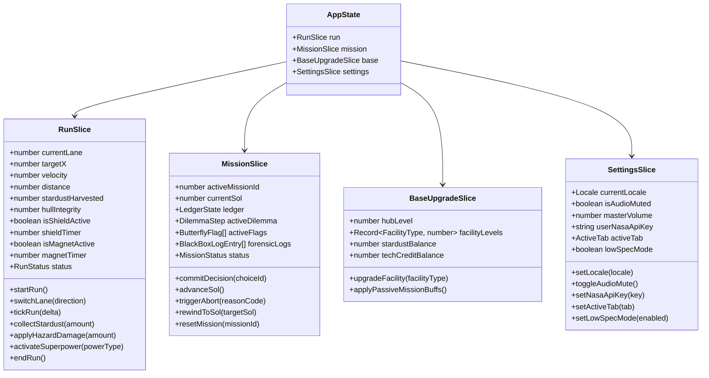

# Technical Requirements Document (TRD)
## CrewReady: Beyond Us | NASA Space Apps Challenge 2026
### Document Identifier: DOCS-03-TRD-V1.0
System Authority: plan.md -> docs/00_PROJECT_CONTEXT.md -> docs/01_PRD.md -> docs/02_SRS.md -> docs/03_TRD.md
Target Platform: Static Client-Side Progressive Web App (PWA)
Runtime Target: Modern Mobile & Desktop Web Browsers (Chrome 100+, Safari 15.4+, Firefox 100+)
Primary Architecture: Decoupled View / Authoritative Zustand Store / Deterministic Rules Engine / Resilient NASA Gateway

---

## 1. Technology Stack Decision Matrix

| Layer / Subsystem | Selected Technology | Version | Engineering Rationale | Alternatives Rejected & Reason |
|---|---|---|---|---|
| **Build Tool & Bundler** | Vite | ^5.4.0 | Sub-second HMR during development; Rollup-based tree-shaking producing minimal static assets; native ES modules. | Webpack (excessive config overhead, slower cold build); Create React App (deprecated, poor bundle splitting). |
| **View Framework** | React (Strict Mode) | ^18.3.1 | Declarative component model; concurrent rendering transitions; robust ecosystem for 3D canvas bridging. | Vanilla JS (fragile DOM synchronization across 5 tabs); Vue/Svelte (smaller 3D ecosystem for R3F-equivalent patterns). |
| **Language & Typings** | TypeScript | ^5.5.3 | Enforces strict type boundaries across the 6-variable coupled ledger, dilemma payloads, and NASA API contracts. | Pure JavaScript (prone to silent NaN/undefined runtime crashes in life-support mass balances). |
| **3D Graphics Engine** | Three.js & React Three Fiber (@react-three/fiber, @react-three/drei) | ^0.168.0 / ^8.17.0 / ^9.112.0 | Declarative WebGL graph; automatic render loop lifecycle; seamless GLTF/GLB loading and memory disposal hooks. | Babylon.js (heavier bundle size > 1MB minified); PlayCanvas (cloud-centric workflow conflicting with offline repo requirements). |
| **Global State Management** | Zustand | ^4.5.5 | Minimal boilerplate (1.2kB); centralized store slices with zero React Context provider re-render cascade penalty. | Redux Toolkit (overly verbose for hackathon lifecycle); Context API (causes pervasive full-tree re-renders on 60 FPS runner ticks). |
| **Styling & HUD Design** | Tailwind CSS | ^3.4.10 | Atomic design token enforcement per `/ui-ux-pro-max`; zero runtime CSS overhead; responsive utility classes for kid-friendly HUD. | CSS Modules (slower iteration); Styled Components (runtime CSS-in-JS injection cost degrading 60 FPS budget). |
| **Iconography** | Lucide React | ^0.441.0 | Tree-shakable clean SVG vectors; zero unicode emoji dependencies; high-contrast aerospace HUD visual clarity. | FontAwesome (heavy web fonts); Unicode emojis (unprofessional, inconsistent cross-platform rendering). |
| **Offline Cache Worker** | Workbox / Custom Service Worker (`sw.js`) | Native CacheStorage API | Cache-First strategy for 3D GLB assets and static JSON fixtures; Stale-While-Revalidate for app shell updates. | Generic PWA plugins (unpredictable caching of large 4MB binary GLB assets). |
| **Unit Testing Engine** | Vitest | ^2.1.0 | Lightning-fast deterministic test execution against pure physics functions and ledger mutation matrices. | Jest (slower ESM TypeScript compilation, heavier node dependency footprint). |

---

## 2. End-to-End System Architecture

The following diagram defines the authoritative data flow. State mutations originate from pure deterministic engines, while the resilient NASA gateway supplies external ground-truth feeds with instant offline fixture fallback:

```mermaid
flowchart TD
    subgraph ClientBrowser [Browser Client Runtime]
        subgraph ViewLayer [View Presentation Layer]
            HUD["Cadet HUD Shell (React 18 + Tailwind)"]
            Canvas3D["3D Viewports (Three.js / React Three Fiber)"]
            Poster2D["Accelerated 2D CSS/SVG Poster Fallbacks"]
        end

        subgraph StateLayer [Authoritative State Hub: Zustand]
            RunSlice["runSlice (Kinematics, Collision, Stardust)"]
            MissionSlice["missionSlice (Ledger, Dilemmas, Butterfly Flags)"]
            BaseSlice["baseUpgradeSlice (Facilities, Tiers, Buffs)"]
            SettingsSlice["settingsSlice (i18n, Audio, NASA API Key)"]
        end

        subgraph EngineLayer [Deterministic Science Engine]
            LedgerEngine["Coupled 6-Variable Ledger Mutator"]
            ECLSSCompute["ECLSS Mass Balance & Stoichiometry (Pure TS)"]
            SolarCompute["Solar Flux & Dust Attenuation (MCS/POWER Model)"]
            BlackBoxClassifier["Forensic Tipping-Point Sol Classifier"]
        end

        subgraph GatewayLayer [Resilient NASA Gateway Service]
            LiveFetcher["NASA Live Client (APOD / EPIC / Images)"]
            FallbackGate{"Timeout >2.5s or Error?"}
            LocalFixtures["Pre-Bundled JSON Fixtures (public/assets/data/)"]
        end

        subgraph StorageLayer [Persistence & Caching]
            LocalStorage[("window.localStorage: crewready_v1_*")]
            ServiceWorkerCache[("ServiceWorker CacheStorage: sw.js (Cache-First)")]
        end
    end

    Canvas3D -.->|"Frame Drop Trigger"| Poster2D
    HUD -->|"User Action / Intent"| StateLayer
    StateLayer -->|"State Query"| EngineLayer
    EngineLayer -->|"State & Ledger Deltas"| StateLayer
    StateLayer -->|"Sync Telemetry"| LocalStorage
    StateLayer -->|"Dispatch Telemetry Fetch"| GatewayLayer
    LiveFetcher --> FallbackGate
    FallbackGate -->|"Success"| HUD
    FallbackGate -->|"Failure / Offline"| LocalFixtures
    LocalFixtures --> HUD
    ServiceWorkerCache -->|"Pre-cached Models, Textures, Fixtures"| ViewLayer
```



---

## 3. Comprehensive Project Directory Structure

```
crewready/
├── public/
│   ├── assets/
│   │   ├── audio/                      # UI SFX and ambient audio (MP3/OGG)
│   │   │   ├── ambience/
│   │   │   ├── nasa/
│   │   │   └── ui/
│   │   ├── data/                       # Verified NASA JSON datasets & offline fixtures
│   │   │   ├── apod_fixtures.json      # Pre-bundled daily space science rewards
│   │   │   ├── epic_fixtures.json      # DSCOVR Earth observation telemetry & vectors
│   │   │   ├── nasa_images_fixtures.json # Astronaut EVA and ISS training photography
│   │   │   ├── mcs_dust_records.json   # Mars Climate Sounder DDR V6.2 optical depth
│   │   │   ├── iss_eclss_rates.json    # Human life support consumption constants
│   │   │   └── missions.json           # Missions 0, 1, 2 dilemmas and coupled options
│   │   ├── locales/                    # Bilingual localization dictionaries
│   │   │   ├── en.json                 # English master strings
│   │   │   └── bn.json                 # Bengali (বাংলা) master strings
│   │   └── models/                     # Compressed 3D GLB assets
│   │       ├── 24584_Curiosity_static.glb
│   │       ├── Apollo Lunar Module.glb
│   │       ├── companion_drone.glb     # Twinkle autonomous scout drone
│   │       └── crew_astronaut.glb
│   ├── favicon.ico
│   ├── manifest.json                   # PWA web app manifest
│   └── sw.js                           # Workbox-based Cache-First service worker
├── src/
│   ├── components/
│   │   ├── 3d/                         # React Three Fiber components
│   │   │   ├── TwinkleDroneCanvas.tsx  # Interactive 3D mentor with idle/alert rigs
│   │   │   ├── RunnerScene.tsx         # 3-lane procedural curved track runner
│   │   │   ├── ObstacleMesh.tsx        # Instanced debris, flares, dust clouds
│   │   │   ├── StardustMesh.tsx        # Instanced collectible regolith crystals
│   │   │   └── CanvasFallbackPoster.tsx # 2D SVG/CSS fallback for low-spec devices
│   │   ├── common/                     # Reusable aerospace HUD primitives
│   │   │   ├── Button.tsx              # Min 44x44px touch targets with active states
│   │   │   ├── TelemetryCard.tsx       # Glassmorphism panels with numeric badges
│   │   │   ├── ProgressBar.tsx         # Linear & radial telemetry meters
│   │   │   └── Modal.tsx               # Accessible dialog overlays
│   │   ├── hud/                        # Persistent interface elements
│   │   │   ├── TopHeaderHUD.tsx        # Rank, Stardust, Credits, Mute, Language
│   │   │   └── BottomNavigationBar.tsx # 5-tab persistent navigation triggers
│   │   └── views/                      # 5 primary application views
│   │       ├── QuickRunView.tsx        # Instant kinetic 3D flight runner view
│   │       ├── MissionsView.tsx        # Mission 0, 1, 2 coupled ledger operations
│   │       ├── BlackBoxDebriefView.tsx # Forensic timeline & APOD reward debrief
│   │       ├── ResourcesBaseView.tsx   # Outpost module upgrades & superpower links
│   │       ├── TrainingDeckView.tsx    # Docking sim, memory grid, NASA photo gallery
│   │       └── ProfileView.tsx         # Cadet dossier, badges, NASA API key manager
│   ├── engine/                         # Pure deterministic science functions
│   │   ├── compute/
│   │   │   ├── eclss.ts                # Mass conservation, O2/H2O stoichiometry
│   │   │   ├── solarFlux.ts            # Solar attenuation P_nominal * exp(-0.75 * tau)
│   │   │   ├── shielding.ts            # Regolith half-value layer attenuation
│   │   │   └── kinematics.ts           # 3-lane lane interpolation & velocity curves
│   │   ├── blackbox/
│   │   │   ├── classifier.ts           # Tipping-point Sol detection algorithm
│   │   │   └── benchmarks.ts           # Real NASA ISS flight rules comparator
│   │   └── rules/
│   │       ├── coupledLedger.ts        # Enforces Delta >= 2 mutations per decision
│   │       └── butterflyQueue.ts       # Delayed causal flag scheduler
│   ├── hooks/                          # Custom React utility hooks
│   │   ├── useAudio.ts                 # Web Audio API wrapper with mute governance
│   │   ├── useI18n.ts                  # Bilingual string resolver with key fallback
│   │   ├── useNasaApi.ts               # Hook connecting components to NASA Gateway
│   │   └── useWebGLDetector.ts         # Hardware benchmark and 2D poster switcher
│   ├── services/
│   │   └── nasa/                       # NASA Open Data & API client layer
│   │       ├── client.ts               # Resilient fetch wrapper with timeout & key logic
│   │       ├── apodService.ts          # Daily Astronomy Picture of the Day adapter
│   │       ├── epicService.ts          # DSCOVR full-disc Earth observation adapter
│   │       └── imagesService.ts        # NASA Image & Video Library search adapter
│   ├── store/                          # Zustand state slices
│   │   ├── slices/
│   │   │   ├── runSlice.ts             # 3D runner kinematics, score, stardust
│   │   │   ├── missionSlice.ts         # 6-resource ledger, dilemmas, black box
│   │   │   ├── baseUpgradeSlice.ts     # Outpost facilities, tiers, passive buffs
│   │   │   └── settingsSlice.ts        # Locale, audio mute, NASA API key
│   │   └── useAppStore.ts              # Unified typed store aggregator
│   ├── types/                          # Global TypeScript interfaces
│   │   ├── engine.d.ts                 # Ledger, Dilemma, Butterfly, Debrief types
│   │   ├── nasa.d.ts                   # APOD, EPIC, NASA Image API payload types
│   │   └── store.d.ts                  # Zustand state slice definitions
│   ├── App.tsx                         # Root component with routing and error boundary
│   ├── index.css                       # Tailwind design tokens and keyframe animations
│   └── main.tsx                        # Client entry point with service worker boot
├── index.html                          # HTML shell with meta tags & WebGL pre-checks
├── package.json
├── tsconfig.json                       # Strict TypeScript configuration
└── vite.config.ts                      # Vite build setup with code-splitting chunks
```

---

## 4. Zustand Store Slice Contracts and State Schemas

### 4.1 State Slice Schema Hierarchy



### 4.2 Exact TypeScript State Slice Interfaces

```typescript
// src/types/store.d.ts

export type ActiveTab = 'quickrun' | 'missions' | 'resources' | 'training' | 'profile';
export type Locale = 'en' | 'bn';
export type RunStatus = 'idle' | 'running' | 'paused' | 'crashed' | 'completed';
export type MissionStatus = 'staging' | 'active' | 'aborted' | 'completed';
export type FacilityType = 'central_hub' | 'solar_farm' | 'water_recycler' | 'hydroponics' | 'shield_dome';

export interface LedgerState {
  powerKw: number;          // Nominal: 0 - 100 kW
  oxygenPercent: number;    // Nominal: 0 - 100 %
  waterLiters: number;      // Nominal: 0 - 500 L
  foodKg: number;           // Nominal: 0 - 300 kg
  shieldingPercent: number; // Nominal: 0 - 100 %
  crewTimeHours: number;    // Nominal: 0 - 24 hrs/sol
}

export interface LedgerDelta {
  powerKw?: number;
  oxygenPercent?: number;
  waterLiters?: number;
  foodKg?: number;
  shieldingPercent?: number;
  crewTimeHours?: number;
  reason: string;
}

export interface ButterflyFlag {
  id: string;
  triggerSol: number;
  description: string;
  appliedDelta: LedgerDelta;
  hasTriggered: boolean;
}

export interface ChoiceOption {
  id: string;
  titleKey: string;
  descriptionKey: string;
  immediateDelta: LedgerDelta;
  scheduledFlag?: ButterflyFlag;
}

export interface DilemmaStep {
  id: string;
  sol: number;
  titleKey: string;
  contextNarrativeKey: string;
  twinkleSocraticKey: string;
  options: [ChoiceOption, ChoiceOption, ...ChoiceOption[]];
}

export interface BlackBoxLogEntry {
  sol: number;
  dilemmaId: string;
  choiceId: string;
  ledgerSnapshot: LedgerState;
  deltasApplied: LedgerDelta;
  activeFlagsSnapshot: string[];
}

export interface RunSliceState {
  currentLane: -1 | 0 | 1;
  targetX: number;
  velocity: number;
  distance: number;
  stardustHarvested: number;
  hullIntegrity: number;
  isShieldActive: boolean;
  shieldRemaining: number;
  isMagnetActive: boolean;
  magnetRemaining: number;
  status: RunStatus;
  startRun: () => void;
  switchLane: (direction: 'left' | 'right') => void;
  tickRun: (deltaMs: number) => void;
  collectStardust: (amount: number) => void;
  applyHazardDamage: (damage: number) => void;
  activateSuperpower: (power: 'shield' | 'magnet') => void;
  endRun: () => void;
}

export interface MissionSliceState {
  activeMissionId: number;
  currentSol: number;
  ledger: LedgerState;
  activeDilemma: DilemmaStep | null;
  activeFlags: ButterflyFlag[];
  forensicLogs: BlackBoxLogEntry[];
  status: MissionStatus;
  tippingPointSol: number | null;
  commitDecision: (choiceId: string) => void;
  advanceSol: () => void;
  triggerAbort: (reason: string) => void;
  rewindToSol: (targetSol: number) => void;
  resetMission: (missionId: number) => void;
}

export interface BaseUpgradeSliceState {
  hubLevel: number;
  facilities: Record<FacilityType, number>;
  stardustBalance: number;
  techCreditBalance: number;
  upgradeFacility: (facility: FacilityType) => boolean;
  addStardust: (amount: number) => void;
  addTechCredits: (amount: number) => void;
}

export interface SettingsSliceState {
  activeTab: ActiveTab;
  currentLocale: Locale;
  isAudioMuted: boolean;
  masterVolume: number;
  userNasaApiKey: string;
  lowSpecMode: boolean;
  setActiveTab: (tab: ActiveTab) => void;
  setLocale: (locale: Locale) => void;
  toggleAudioMute: () => void;
  setMasterVolume: (volume: number) => void;
  setUserNasaApiKey: (key: string) => void;
  setLowSpecMode: (enabled: boolean) => void;
}
```

---

## 5. 3D Engine Architecture & WebGL Hygiene

### 5.1 Runner Loop, Track Curvature & Object Pooling
- **Procedural Track Pipeline**: Generates an infinite forward curved runway segmented into discrete track segments (length $L = 50.0\text{ m}$). As segment $S_k$ falls behind the camera ($z_{cam} - z_k > 20.0\text{ m}$), it is recycled to $z_{front} + L$ with dynamic polynomial curvature $x_{curve}(z) = A \cdot \sin(B \cdot z)$.
- **Object Pooling Strategy**:
  - Pre-allocates static pool arrays: 30 `KesslerDebris` meshes, 20 `SolarParticleRing` instances, and 80 `StardustCrystal` nodes.
  - Zero dynamic heap instantiation during runtime frames (`new THREE.Mesh()` inside `requestAnimationFrame` is strictly prohibited).
  - Invisible objects are repositioned ahead of the spacecraft along available lane coordinates and flagged active.
- **Bounding Box Collision Algorithm**:
  - Evaluates axis-aligned bounding boxes (AABB) in pure TypeScript:
    $$\text{Overlap} \iff |x_c - x_h| < \frac{w_c + w_h}{2} \land |y_c - y_h| < \frac{h_c + h_h}{2} \land |z_c - z_h| < \frac{d_c + d_h}{2}$$
  - Broad-phase filtering discards all entities where $|z_c - z_h| > 5.0\text{ m}$.

### 5.2 Twinkle Scout Drone Rendering & State Rigging
- **Model Geometry**: Loaded from `public/assets/models/companion_drone.glb` using Drei `useGLTF`.
- **Procedural Floating Physics**: Drone applies an organic vertical hover bobbing equation:
  $$y_{drone}(t) = y_0 + 0.12 \cdot \sin(1.8 \cdot t) + 0.04 \cdot \cos(3.2 \cdot t)$$
- **Interaction Animation States**:
  - `IDLE`: Smooth rhythmic hovering, pulsing cyan telemetry eye ring (`#36D9F5`).
  - `ALERT`: Rapid horizontal jitter, pitch tilt of $+15^\circ$, warning crimson glow (`#FF5252`).
  - `FLY`: Forward pitch tilt of $-25^\circ$, trailing dual ion thruster particle sprites.

### 5.3 WebGL Hygiene & 2D Poster Fallback Protocol
- **Geometry & Texture Disposal Lifecycle**:
  ```typescript
  useEffect(() => {
    return () => {
      scene.traverse((object) => {
        if (object instanceof THREE.Mesh) {
          object.geometry?.dispose();
          if (Array.isArray(object.material)) {
            object.material.forEach((mat) => mat.dispose());
          } else {
            object.material?.dispose();
          }
        }
      });
    };
  }, []);
  ```
- **Device Pixel Ratio (DPR) Clamping**: Capped via `dpr={Math.min(window.devicePixelRatio, 1.5)}` to prevent GPU fill-rate throttling on ultra-high-density mobile displays (e.g., iPhone Retina / 4K displays).
- **Graceful 2D Fallback Switcher**:
  - Monitored by `useWebGLDetector.ts`.
  - If WebGL 2 context creation fails, or frame delta exceeds 33.3ms for >180 consecutive frames, `lowSpecMode` automatically triggers.
  - The canvas component unmounts and swaps with `CanvasFallbackPoster.tsx` (an accelerated SVG/CSS vector interface preserving identical touch controls, counters, and decision modals).

---

## 6. Offline PWA & Resilient NASA Data Gateway

### 6.1 Service Worker Caching Architecture (`sw.js`)
The application registers a service worker implementing targeted Workbox caching strategies:
1. **Core HTML/JS/CSS App Shell**: Stale-While-Revalidate with automatic background cache update.
2. **Binary 3D Models (`.glb`) & UI Audio (`.mp3`, `.ogg`)**: Cache-First strategy with 30-day expiration, guaranteeing instant cold loading without network round-trips.
3. **Pre-Bundled Data Fixtures (`public/assets/data/*.json`)**: Cache-First strategy, ensuring authoritative offline gameplay baseline.

### 6.2 Resilient NASA API Service Gateway
The NASA API service provides live space telemetry without ever jeopardizing application stability:

```typescript
// src/services/nasa/client.ts

export async function fetchNasaWithFallback<T>(
  liveEndpointUrl: string,
  fallbackFixturePath: string,
  timeoutMs = 2500
): Promise<{ data: T; source: 'NASA LIVE' | 'OFFLINE ARCHIVE' }> {
  // 1. Resolve API Key in strict priority order
  const userKey = localStorage.getItem('crewready_v1_nasa_api_key');
  const envKey = import.meta.env.VITE_NASA_API_KEY;
  const resolvedKey = userKey && userKey.trim() !== '' ? userKey : envKey || 'DEMO_KEY';

  const separator = liveEndpointUrl.includes('?') ? '&' : '?';
  const authenticatedUrl = `${liveEndpointUrl}${separator}api_key=${resolvedKey}`;

  // 2. Wrap network request in a strict 2500ms AbortController timeout
  const controller = new AbortController();
  const timeoutId = setTimeout(() => controller.abort(), timeoutMs);

  try {
    if (!navigator.onLine) {
      throw new Error('Client offline');
    }

    const response = await fetch(authenticatedUrl, { signal: controller.signal });
    clearTimeout(timeoutId);

    if (!response.ok) {
      throw new Error(`HTTP Error ${response.status}`);
    }

    const liveData = (await response.json()) as T;
    return { data: liveData, source: 'NASA LIVE' };
  } catch (error) {
    clearTimeout(timeoutId);
    // 3. Silent fallback to pre-bundled local JSON fixture
    const fallbackResponse = await fetch(fallbackFixturePath);
    const fixtureData = (await fallbackResponse.json()) as T;
    return { data: fixtureData, source: 'OFFLINE ARCHIVE' };
  }
}
```

---

## 7. Performance Budget & Optimization Strategy

| Metric / Constraint | Target Budget | Enforcement Mechanism |
|---|---|---|
| **Compressed Bundle Size** | $< 1.8\text{ MB}$ gzip (Total) | Dynamic imports (`React.lazy()`) for all 5 primary views; Three.js tree-shaking; manual Rollup chunking separating vendor libraries. |
| **3D GLB Model Asset Ceiling** | $< 4.5\text{ MB}$ uncompressed | Draco geometry compression via gltf-pipeline; 1024x1024 maximum texture atlas maps. |
| **Cold Start First Contentful Paint (FCP)**| $< 1.2\text{ s}$ on 4G Mobile | Inline critical HUD CSS; deferred loading of 3D canvas until navigation shell mounts. |
| **Sustained Frame Time** | $< 16.6\text{ ms}$ (60 FPS) | InstancedMesh for stardust and debris; zero object allocation in render loop; DPR clamped to 1.5 max. |
| **Eliminating React Waterfalls** | Zero component-level fetch cascades | Static data and pre-bundled JSON fixtures loaded eagerly in parallel on initial app mount; Zustand slices pre-seeded. |
| **Accessibility & Color Contrast** | WCAG 2.1 AA Compliant ($\ge 4.5:1$) | Enforced via Tailwind color palette; all resource alerts combine Lucide SVG icons, text labels, and numeric values. |
